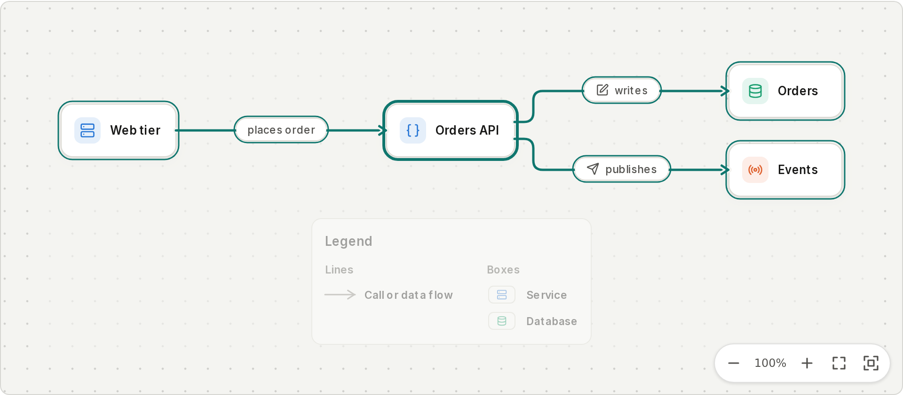
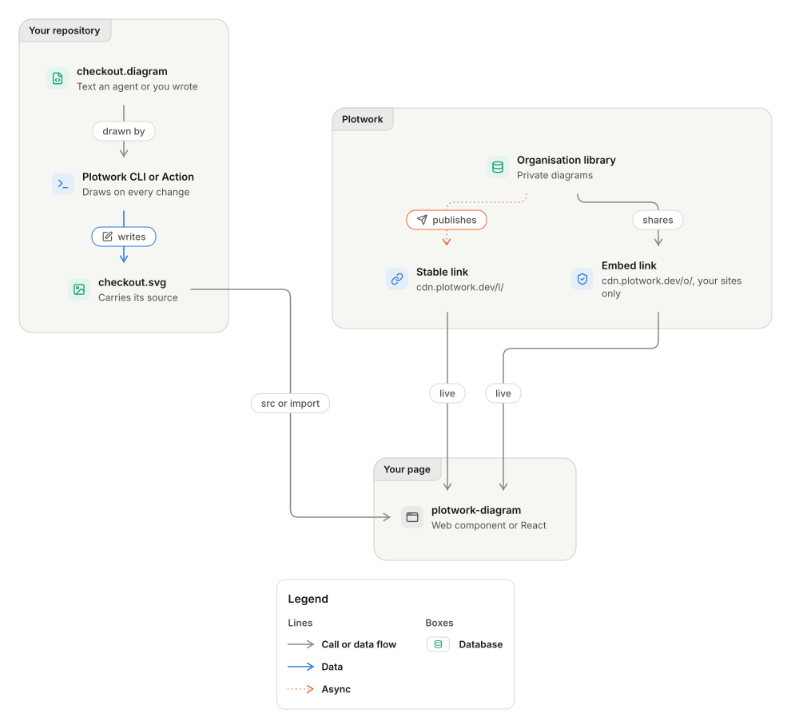
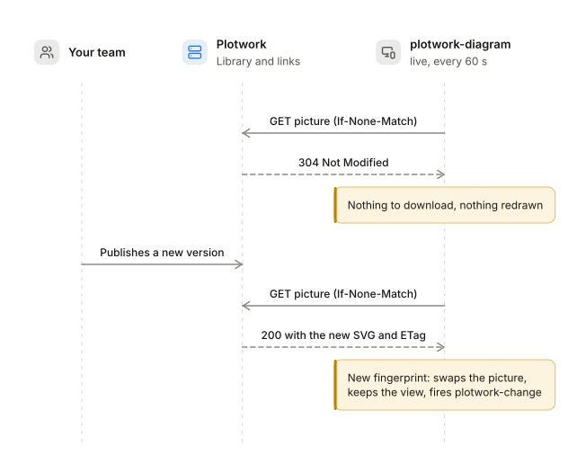

<p align="center">
  <a href="https://plotwork.dev">
    <picture>
      <source media="(prefers-color-scheme: dark)" srcset="https://plotwork.dev/brand/logo/plotwork-lockup-on-dark.svg">
      
    </picture>
  </a>
</p>

<h3 align="center">Interactive Plotwork diagrams in your own pages and apps</h3>

<p align="center">
  Pan, zoom, trace and drill into the diagrams your team and your AI agents keep in Plotwork,<br>
  from your repository or your organisation's library, kept current when a new version is published.
</p>

<p align="center">
  <a href="https://www.npmjs.com/package/@plotwork.official/viewer"></a>
  <a href="https://www.npmjs.com/package/@plotwork.official/viewer#provenance"></a>
  <a href="#supply-chain"></a>
  <a href="https://github.com/plotwork-official/plotwork-sdk/actions/workflows/ci.yml"></a>
  
  <a href="./LICENSE"></a>
</p>

<p align="center">
  <a href="https://plotwork.dev">Website</a> &nbsp;·&nbsp;
  <a href="https://docs.plotwork.dev">Docs</a> &nbsp;·&nbsp;
  <a href="./packages/viewer/README.md">Viewer reference</a> &nbsp;·&nbsp;
  <a href="./spec/picture.md">Picture contract</a> &nbsp;·&nbsp;
  <a href="./examples/vanilla/index.html">Example</a>
</p>

<p align="center">
  <a href="https://youtu.be/zE66NDZ7xdw">
    <picture>
      <source media="(prefers-color-scheme: dark)" srcset="https://assets.plotwork.dev/media/films/sdk/readme-dark.webp">
      
    </picture>
  </a>
  <br>
  <sub>The real component in an app, recorded by <code>pnpm film</code>. Select it to watch on YouTube. New to Plotwork? <a href="https://www.youtube.com/watch?v=HiuSK_mojOs">Watch the product film</a>.</sub>
</p>

## TL;DR

| Question | Answer |
|---|---|
| What is it? | `<plotwork-diagram>`, a web component, and `<PlotworkDiagram>` for React, that show any picture the Plotwork engine drew, with the interactions of the Plotwork portal. |
| Where do pictures come from? | A file in your repository, a hosted picture, a stable link, or your organisation's library through an embed link. |
| Does it stay current? | Add `live`: it checks for a new version every minute while the page is in view, and swaps it in without a reload. |
| What does it install? | Nothing else. No runtime dependencies, React as an optional peer, and every release is published from CI with a signed provenance statement. |
| Does it phone home? | No. It fetches only the address you give it, with no cookie. |
| Can a picture run script in my page? | No. It is shown as an image, and the element never builds markup from text. |
| Other languages? | Every package is built against [`spec/`](./spec/README.md), one contract and one set of fixtures for every language. |

## What it does

<table>
  <tr>
    <td width="33%" valign="top">
      <br>
      <b>Pan and zoom</b><br>
      Drag, pinch, wheel, double press and the keys. It fits the diagram to its box and keeps it fitted as the page resizes.
    </td>
    <td width="33%" valign="top">
      <br>
      <b>Trace a box's lines</b><br>
      Hover or press a box: everything else steps back, and its lines, labels and the boxes at the other end light up.
    </td>
    <td width="33%" valign="top">
      <br>
      <b>Drill into a part</b><br>
      A box that names a part of its series (<code>part=</code>) sends <code>plotwork-drill</code>, and your page opens the detail.
    </td>
  </tr>
  <tr>
    <td valign="top">
      <br>
      <b>Live updates</b><br>
      Revalidates the address on an interval. An unchanged diagram costs a 304; a new version swaps in and keeps your view.
    </td>
    <td valign="top">
      <br>
      <b>Pin a version</b><br>
      <code>fingerprint="sha256-..."</code> shows the diagram only when it is exactly that one, like subresource integrity.
    </td>
    <td valign="top">
      <br>
      <b>Light and dark</b><br>
      Follows the page, or is forced with <code>theme</code>. Themed through <code>--plotwork-*</code> properties and <code>::part</code>.
    </td>
  </tr>
  <tr>
    <td valign="top">
      <br>
      <b>Safe by construction</b><br>
      The picture is an image from a <code>blob:</code> address, so nothing in it runs. No cookie, no third party.
    </td>
    <td valign="top">
      <br>
      <b>Accessible</b><br>
      One tab stop with a name, labelled controls, traces and updates said politely, reduced motion honoured, any language.
    </td>
    <td valign="top">
      <br>
      <b>Zero dependencies</b><br>
      37 kB packed, plain ES modules with types. Works with any bundler, or none.
    </td>
  </tr>
</table>

## See it

<p align="center">
  <picture>
    <source media="(prefers-color-scheme: dark)" srcset="./docs/assets/viewer-dark.png">
    
  </picture>
  <br>
  <sub>A checkout flow in <code>&lt;plotwork-diagram&gt;</code>, with the pointer over Orders API.</sub>
</p>

## Quick start

```bash
npm install @plotwork.official/viewer
```

**Any page**

```html
<script type="module">
  import '@plotwork.official/viewer/register'
</script>

<plotwork-diagram src="/diagrams/checkout.svg" label="Checkout flow"></plotwork-diagram>
```

**React**

```tsx
import { PlotworkDiagram } from '@plotwork.official/viewer/react'

export function Architecture() {
  return (
    <PlotworkDiagram
      src="https://cdn.plotwork.dev/l/<your stable link>.svg"
      live
      onDrill={({ part }) => openPart(part)}
    />
  )
}
```

**A `.diagram` file in a Vite app**

```ts
// vite.config.ts
import { plotwork } from '@plotwork.official/vite'
export default defineConfig({ plugins: [plotwork()] })
```

```tsx
import checkout from './diagrams/checkout.diagram'

<PlotworkDiagram svg={checkout} />
```

**Script the API**

```ts
import { Plotwork } from '@plotwork.official/sdk'

const plotwork = new Plotwork({ apiKey: process.env.PLOTWORK_API_KEY })
const checked = await plotwork.diagrams.validate({ source })
```

The viewer renders as the bare element on a server and comes alive in the browser. Every attribute, method, event and style hook is in the [viewer reference](./packages/viewer/README.md).

## Where the pictures come from

<p align="center">
  
</p>

| You want | Use |
|---|---|
| The diagram in your repository, redrawn with the code | The Plotwork [command line](https://docs.plotwork.dev/cli/commands) or [GitHub Action](https://docs.plotwork.dev/diagrams-in-ci) writes the SVG; point `src` at it. |
| The latest published version, without a redeploy | A stable link (`cdn.plotwork.dev/l/...`) with `live`. |
| A private diagram from your organisation's library | An embed link (`cdn.plotwork.dev/o/...`) the owner made for your site, with `live`. Other sites get a placeholder, and the source is never sent. |
| Exactly one version, refused if it changes | `fingerprint="sha256-..."`. |

## How live updates work

<p align="center">
  
</p>

The viewer only checks while its page is in view, never more often than every 15 seconds, and a check that fails leaves the diagram on screen.

## Packages

| Package | Status | What it is |
|---|---|---|
| [`@plotwork.official/viewer`](./packages/viewer/README.md) |  | `<plotwork-diagram>`, `<PlotworkDiagram>` for React, and the core with no element (`/core`). |
| [`@plotwork.official/vite`](./packages/vite/README.md) |  | `import checkout from './checkout.diagram'`: drawn at build time by the command line and redrawn on save, so no engine reaches the browser. |
| [`@plotwork.official/sdk`](./packages/sdk/README.md) |  | Every `/v1` operation of the Plotwork API, typed from its OpenAPI document, on `fetch` alone. |
| `plotwork` on PyPI | planned | The API client for Python, standard library only. |

## Supply chain

| Measure | Where |
|---|---|
| No runtime dependencies in any published package; CI fails if one appears | [`scripts/check-no-runtime-dependencies.mjs`](./scripts/check-no-runtime-dependencies.mjs) |
| Published only from CI by npm trusted publishing (OIDC, no token), with a signed provenance statement | [`.github/workflows/publish.yml`](./.github/workflows/README.md) |
| Exact versions, frozen lockfile, no install scripts | [`.npmrc`](./.npmrc), CI |
| New dependency versions wait a week | [`pnpm-workspace.yaml`](./pnpm-workspace.yaml), [`renovate.json`](./renovate.json) |
| Every action pinned to a commit | [`.github/workflows/`](./.github/workflows/) |

Check a release yourself with `npm audit signatures` after installing it.

## Develop

```bash
git clone git@github.com:plotwork-official/plotwork-sdk.git
cd plotwork-sdk
pnpm install
pnpm check
```

`pnpm shots` draws the screenshots above from the real component. The diagrams in this README are Plotwork source in [`docs/diagrams/`](./docs/diagrams/), drawn by the command line. The repository follows the engineering standards in `.standards/`; see [CLAUDE.md](./CLAUDE.md).

## Community

<p>
  <a href="https://www.youtube.com/@plotwork-official"></a>
  <a href="https://www.linkedin.com/company/plotwork-dev"></a>
  <a href="https://x.com/plotwork_"></a>
  <a href="https://bsky.app/profile/plotwork.bsky.social"></a>
  <a href="https://mastodon.social/@plotwork"></a>
  <a href="https://www.instagram.com/plotwork.official"></a>
  <a href="https://discord.gg/gcAz5RJyu"></a>
</p>

## See also

| Page | Why |
|---|---|
| [Viewer reference](./packages/viewer/README.md) | Attributes, events, theming, content security policy |
| [Picture contract](./spec/picture.md) | What every SDK reads from a picture |
| [Plotwork docs](https://docs.plotwork.dev) | Writing diagrams, the command line, the MCP server, organisations |

<p align="center"><sub>MIT licence. Cloud provider names and icons in diagrams are trademarks of their owners.</sub></p>
