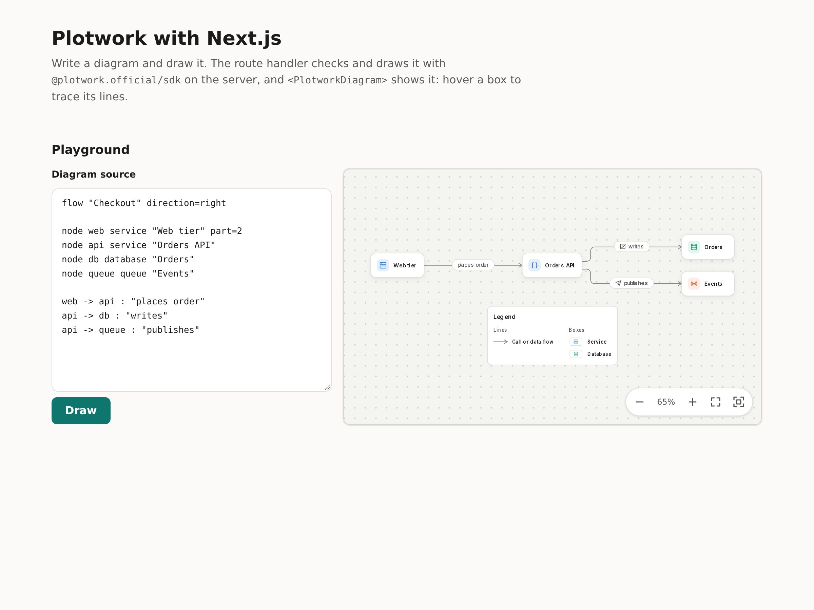

  <a href="https://plotwork.dev">
    <picture>
      <source media="(prefers-color-scheme: dark)" srcset="https://plotwork.dev/brand/logo/plotwork-lockup-on-dark.svg">
      
    </picture>
  </a>

# Plotwork with Next.js

A Next.js App Router app that signs people in with Plotwork and shows their own diagrams, and checks and draws diagrams on its server with an API key, all with [`@plotwork.official/sdk`](../../packages/sdk/README.md), shown with `<PlotworkDiagram>` from [`@plotwork.official/viewer`](../../packages/viewer/README.md).

## TL;DR

| Question | Answer |
|---|---|
| What does it show? | Sign in with Plotwork: the person's name and library, and the diagram they choose. A playground: edit a diagram, press Draw, see the picture or every mistake with its line, column and hint. Optionally, a stable link followed live. |
| Which kind of app? | A confidential app: the client secret and the person's tokens stay on this server, in a sealed HTTP-only cookie. |
| Where does the key live? | In `.env.local`, read only by the route handler `app/api/draw/route.ts`. It never reaches the browser. |
| Which versions? | Next.js 16.4.2, React 19.3.0, exact versions with a lockfile. |
| Server rendering? | Yes. The viewer renders as the bare element on the server and comes alive in the browser. |
| What does it need? | Node 20.9 or later. A registered app to sign in; a Plotwork API key for the playground. Each part works without the other. |

  <picture>
    <source media="(prefers-color-scheme: dark)" srcset="../../docs/assets/examples/nextjs-dark.png">
    
  </picture>

## Run it

1. Copy this folder, or clone the repository and open `examples/nextjs`.
2. Install: `npm install`
3. Copy the settings: `cp .env.example .env.local`
4. To sign in, register an app as in [Sign in with Plotwork](#sign-in-with-plotwork) and set its four variables.
5. For the playground, make a key on the Keys page of [app.plotwork.dev](https://app.plotwork.dev) and set `PLOTWORK_API_KEY`.
6. Start it: `npm run dev`, then open http://localhost:3000.

| Variable | Needed | What it is |
|---|---|---|
| `PLOTWORK_CLIENT_ID` | To sign in | The app's client id, from Developer apps. |
| `PLOTWORK_CLIENT_SECRET` | To sign in | The app's secret (`pws_...`), shown once when the app is registered. Server only. |
| `APP_URL` | To sign in | This app's address, `http://localhost:3000` in development. The redirect address is this plus `/auth/plotwork/callback`. Cookies are `Secure` when it is https. |
| `SESSION_SECRET` | To sign in | At least 32 characters that seal the cookies: `openssl rand -base64 32`. Changing it signs everyone out. |
| `PLOTWORK_API_KEY` | For the playground | Your API key. Server only: never prefix it with `NEXT_PUBLIC_`. |
| `PLOTWORK_BASE_URL` | No | `https://api.plotwork.dev` by default; `https://api-preview.plotwork.dev` for preview. Sign-in and the API calls both use it, so register the app on the same one. |
| `NEXT_PUBLIC_PLOTWORK_STABLE_LINK` | No | A stable link such as `https://cdn.plotwork.dev/l/<token>.svg`. It is public, so it may reach the browser. Read at build time. |

## Sign in with Plotwork

1. Open Developers, then Developer apps, in the portal: [app.plotwork.dev](https://app.plotwork.dev), or [app-preview.plotwork.dev](https://app-preview.plotwork.dev) with `PLOTWORK_BASE_URL=https://api-preview.plotwork.dev`.
2. Register an app with a name you choose, type **Confidential**, and the redirect address `http://localhost:3000/auth/plotwork/callback`.
3. Copy the client id into `PLOTWORK_CLIENT_ID` and the secret, shown once, into `PLOTWORK_CLIENT_SECRET`. Set `APP_URL=http://localhost:3000` and `SESSION_SECRET`.
4. Restart `npm run dev`, press **Sign in with Plotwork**, and approve the app on Plotwork.

You come back signed in: the page names you, lists your library, and shows the diagram you choose, private ones included. Sign out revokes the grant, so the app also leaves Connected apps in your Plotwork settings.

| Step | Where | What happens |
|---|---|---|
| Start | `app/auth/plotwork/route.ts` | `createPkce()` and `authorizeUrl()` with `profile library:read diagrams:use`. The verifier and state go in a sealed cookie for ten minutes, sent only to `/auth/plotwork`. |
| Come back | `app/auth/plotwork/callback/route.ts` | `parseRedirect()` checks the state and the issuer, then `exchangeCode()` with the secret. The token set goes in the sealed session cookie. A refusal goes home with its OAuth code, which the page explains. |
| Library | `app/api/library/route.ts` | `plotwork.me()` and `plotwork.library.list()` with `withRefresh()`. A refreshed token set is written back to the cookie on the same answer. |
| Picture | `app/api/picture/[id]/route.ts` | `plotwork.library.picture(id, { etag })`, passed on with the API's ETag, so an unchanged picture is a 304. `<PlotworkDiagram>` reads it with a `fetch` that sends this origin's cookie. |
| Sign out | `app/auth/signout/route.ts` | A form posts here. `revokeToken()` ends the grant, and the cookie is cleared. |

The cookies are `HttpOnly`, `SameSite=Lax`, and `Secure` on https. They are sealed with AES-GCM under a key derived from `SESSION_SECRET` (`lib/session.ts`, Web Crypto only), and the cookie's name is bound into the seal, so the browser can neither read the tokens nor swap one cookie for the other.

## What you will see

| Part | How it works |
|---|---|
| Sign in with Plotwork | A button when signed out; your name, your library and the chosen diagram when signed in. Without the four variables, the page says how to register an app. |
| Playground | The page posts the source to `/api/draw`. The route calls `plotwork.diagrams.validate`, then `plotwork.diagrams.render` with `scheme: 'auto'`, and returns `{ svg }` or `{ errors }`. Press a mistake's line to put the cursor there. |
| Picture | `<PlotworkDiagram svg={svg} />` in a `'use client'` file. Hover a box to trace its lines; pan, zoom and full screen from the toolbar. |
| Live section | Shown only when `NEXT_PUBLIC_PLOTWORK_STABLE_LINK` is set: `<PlotworkDiagram src={link} live />` swaps in a new version when one is published. |
| No key | The playground says how to add one instead of failing. Sign-in works without it. |

## Files

| Path | What it is |
|---|---|
| `lib/sign-in.ts` | The sign-in settings, the cookies, and `asPerson()`, which runs calls as the signed-in person and saves rotated tokens. |
| `lib/session.ts` | Sealing a cookie with AES-GCM. |
| `app/auth/plotwork/route.ts`, `app/auth/plotwork/callback/route.ts`, `app/auth/signout/route.ts` | Start, finish and end a sign-in. |
| `app/api/library/route.ts`, `app/api/picture/[id]/route.ts` | The person's name and library, and one picture of it, through this server. |
| `app/library.tsx` | The client component: who is signed in, the list, and the chosen picture. |
| `app/api/draw/route.ts` | The only code that holds the key. Refuses source over 20,000 characters. |
| `app/playground.tsx` | The client component: text box, Draw button, mistakes and picture. |
| `app/live-diagram.tsx` | The live stable link. |
| `app/page.tsx` | Reads the environment per request and lays out the page. |

## Before you deploy

The route draws whatever it is sent with your key, so on a public site put it behind your own sign-in or a rate limit; every call counts against your key's plan. The dependencies are pinned with a lockfile so a clone installs exactly what CI built.

| Check | Why |
|---|---|
| Register the production redirect address | `https://your-app.example/auth/plotwork/callback`, with `APP_URL` set to match. Addresses match exactly. |
| Keep `PLOTWORK_CLIENT_SECRET` and `SESSION_SECRET` in your host's secret store | Either one leaked lets someone act as the app, or open its cookies. |
| Keep tokens in a server-side store for heavy use | A refresh token works once. Two requests that refresh the same session at the same moment, such as two tabs an hour after sign-in, can spend it twice, which ends the grant. A store with a lock per person avoids that; this example keeps the cookie for simplicity. |

## See also

| Page | Why |
|---|---|
| [React and Vite example](../react-vite/README.md) | `.diagram` files bundled at build time, and sign-in as a public app with no server |
| [Sign in with Plotwork](../../packages/sdk/README.md#sign-in-with-plotwork) | The OAuth helpers |
| [Examples](../README.md) | Every example |
| [API client](../../packages/sdk/README.md) | Every `/v1` call, errors, retries |
| [Viewer reference](../../packages/viewer/README.md) | Attributes, events, theming |
