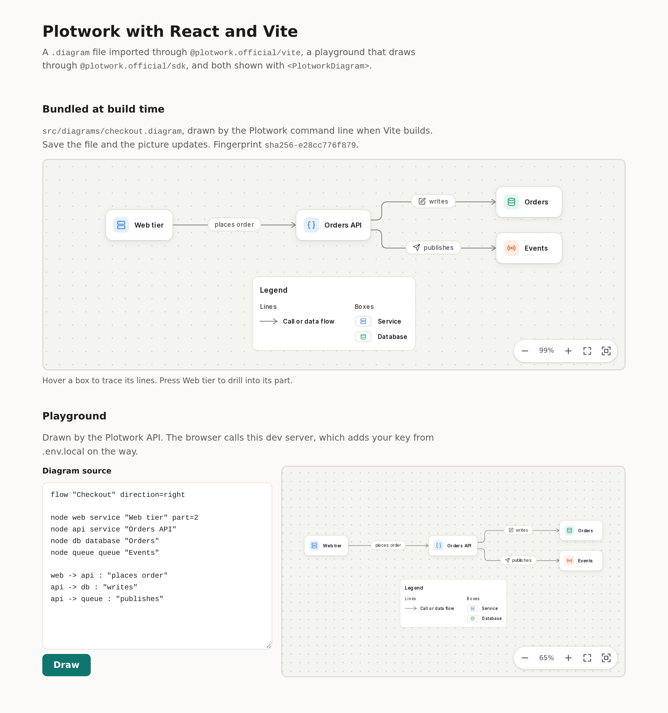

  <a href="https://plotwork.dev">
    <picture>
      <source media="(prefers-color-scheme: dark)" srcset="https://plotwork.dev/brand/logo/plotwork-lockup-on-dark.svg">
      
    </picture>
  </a>

# Plotwork with React and Vite

A React app built with Vite that imports a `.diagram` file through [`@plotwork.official/vite`](../../packages/vite/README.md), signs people in with Plotwork to show their own diagrams, draws more through [`@plotwork.official/sdk`](../../packages/sdk/README.md), and shows them all with `<PlotworkDiagram>` from [`@plotwork.official/viewer`](../../packages/viewer/README.md).

  

## TL;DR

| Question | Answer |
|---|---|
| What does it show? | A diagram drawn at build time with drill and trace events in a status line, Sign in with Plotwork with the person's library in `<PlotworkLibrary>`, a playground that draws through the API, and optionally a stable link followed live. |
| Which kind of app? | For sign-in, a public app: no server and no secret. The browser trades the code itself with PKCE and sends the person's token straight to the Plotwork API. |
| Does the bundled diagram need a key? | No. The Plotwork command line in your `devDependencies` draws it offline when Vite builds. |
| Where does the key live? | In `.env.local`, read by the dev server, which adds it to the playground's calls on the way to the API. It has no `VITE_` prefix, so it is never in the bundle. |
| Which versions? | Vite 6.4.3, React 19.3.0, the Plotwork command line 0.8.0, exact versions with a lockfile. |
| What does it need? | Node 22.12 or later. A registered public app to sign in, and a Plotwork API key for the playground; each part works without the other. |

  <picture>
    <source media="(prefers-color-scheme: dark)" srcset="../../docs/assets/examples/react-vite-dark.png">
    
  </picture>

## Run it

1. Copy this folder, or clone the repository and open `examples/react-vite`.
2. Install: `npm install`
3. Copy the settings: `cp .env.example .env.local`
4. For the playground, make a key on the Keys page of [app.plotwork.dev](https://app.plotwork.dev) and set `PLOTWORK_API_KEY` in `.env.local`.
5. To sign in, register an app as in [Sign in with Plotwork](#sign-in-with-plotwork) and set `VITE_PLOTWORK_CLIENT_ID`.
6. Start it: `npm run dev`, then open http://localhost:5173.

| Variable | Needed | What it is |
|---|---|---|
| `PLOTWORK_API_KEY` | For the playground | Your API key, read by the dev server. Never prefix it with `VITE_`. |
| `PLOTWORK_BASE_URL` | No | Where the dev server forwards: `https://api.plotwork.dev` by default, `https://api-preview.plotwork.dev` for preview. |
| `VITE_PLOTWORK_CLIENT_ID` | To sign in | The client id of a public app. Public, so it is safe in the bundle. |
| `VITE_PLOTWORK_BASE_URL` | No | The API the page signs in with and reads the library from: production by default, `https://api-preview.plotwork.dev` for preview. |
| `VITE_PLOTWORK_STABLE_LINK` | No | A stable link such as `https://cdn.plotwork.dev/l/<token>.svg`. It is public, so it is safe in the bundle. |

## Sign in with Plotwork

1. Open Developers, then Developer apps, in the portal: [app.plotwork.dev](https://app.plotwork.dev), or [app-preview.plotwork.dev](https://app-preview.plotwork.dev) with `VITE_PLOTWORK_BASE_URL=https://api-preview.plotwork.dev`.
2. Register an app with a name you choose, type **Public**, and the redirect address `http://localhost:5173/callback`.
3. Set `VITE_PLOTWORK_CLIENT_ID` in `.env.local` to its client id.
4. Restart `npm run dev`, press **Sign in with Plotwork**, and approve the app on Plotwork.

You come back to `/callback`, which the page handles itself and then replaces with `/`. The page names you, `<PlotworkLibrary>` lists your diagrams, and the one you choose opens in `<PlotworkDiagram>`, private ones included. Sign out revokes the grant.

| Step | Where | What happens |
|---|---|---|
| Start | `startSignIn()` in `src/sign-in.ts` | `createPkce()` and `authorizeUrl()` with `profile library:read`. The verifier and state wait in `sessionStorage` for the trip back. |
| Come back | `loadSignIn()` on `/callback` | `parseRedirect()` checks the state and the issuer, then `exchangeCode()` with the verifier and no secret. It runs once per page load, so React's strict mode cannot spend the code twice. |
| Show | `src/SignIn.tsx` | `plotwork.me()` for the name; `<PlotworkLibrary token>` lists the library; `<PlotworkDiagram src={pictureUrl} token>` shows the choice. The token is a `withRefresh()` function, so a picture keeps working past the hour. |
| Sign out | `signOut()` | `revokeToken()` with the refresh token ends the grant, and the page forgets the tokens. |

### Where the tokens are kept

| Token | Kept in | Trade-off |
|---|---|---|
| Access token, one hour | Memory only | Gone at a reload; a new one is fetched with the refresh token. |
| Refresh token, 30 days, rotated at each use | `sessionStorage` of this tab | A reload stays signed in, and a new tab starts signed out. Any script on the page can read `sessionStorage`, so a cross-site scripting hole would leak it; a stolen copy used after yours ends the grant. For less exposure, keep it in memory only (remove `saveRefresh` and `readRefresh`): the person signs in again after a reload. An app with a server should keep tokens there, as the [Next.js example](../nextjs/README.md) does. |

The viewer sends the token only over https or to this computer, never with a cookie. With a content security policy, allow `https://api.plotwork.dev` (or the preview API) in `connect-src`.

## What you will see

| Part | How it works |
|---|---|
| Bundled at build time | `import checkout, { fingerprint } from './diagrams/checkout.diagram'`. Save the file and the picture updates, keeping your zoom. Hover a box and the status line names it (`onTrace`); press Web tier, which has `part=2`, and it says which part to open (`onDrill`). |
| Sign in with Plotwork | A button when signed out; your name, your library and the chosen diagram when signed in. Without `VITE_PLOTWORK_CLIENT_ID`, the section says how to register an app. |
| Playground | Starts with the same file (`?raw`). The browser calls `plotwork.diagrams.validate` and `render` on its own origin with no key; `vite.config.ts` forwards `/v1` to the API and adds `X-API-Key`. Mistakes come back as data with a line, column and hint. |
| Live section | Shown only when `VITE_PLOTWORK_STABLE_LINK` is set: `<PlotworkDiagram src={link} live />`. |
| No key | The playground says how to add one; the bundled diagram still shows. |

## The proxy is for local development

`server.proxy` and `preview.proxy` in `vite.config.ts` exist only in `npm run dev` and `npm run preview`. A deployed app has no Vite server, so it calls the Plotwork API from its own server (a route or function that holds the key), as the [Next.js example](../nextjs/README.md) does. Never put the key in the browser bundle.

## Files

| Path | What it is |
|---|---|
| `vite.config.ts` | The plugin, and the `/v1` proxy that adds the key. |
| `src/diagrams/checkout.diagram` | The diagram bundled at build time. |
| `src/App.tsx` | The bundled diagram, its status line, and the live section. |
| `src/Playground.tsx` | The text box, Draw button, mistakes and picture. |
| `src/sign-in.ts` | Sign in with Plotwork for a page with no server: start, finish, resume after a reload, sign out. |
| `src/SignIn.tsx` | Who is signed in, the library picker and the chosen picture. |

## See also

| Page | Why |
|---|---|
| [Next.js example](../nextjs/README.md) | Drawing on your own server, and sign-in as a confidential app |
| [Sign in with Plotwork](../../packages/sdk/README.md#sign-in-with-plotwork) | The OAuth helpers |
| [Examples](../README.md) | Every example |
| [Vite plugin](../../packages/vite/README.md) | Options, hot reload |
| [Viewer reference](../../packages/viewer/README.md) | Attributes, events, theming |
